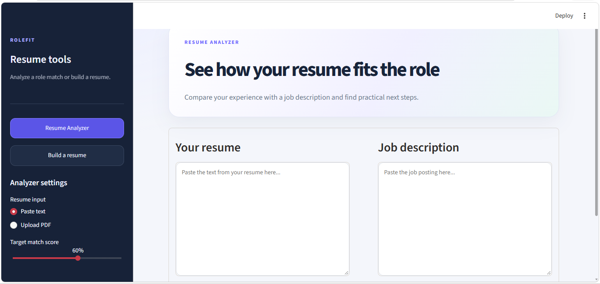
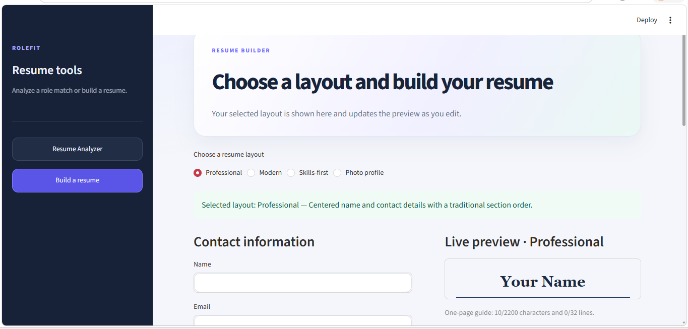

# RoleFit
https://rolefit-resume-analyzer-dqw2ter2oz7gdbvxdumk7q.streamlit.app/
RoleFit is a Python app that helps users compare a resume with a job description and create a resume in a chosen layout.

## App Previews

### Resume Analyzer



### Resume Builder



## Features

### Resume Analyzer

- Paste resume text or upload a text-based PDF.
- Compare resume skills with skills found in a job description.
- Set a target skill-match percentage.
- Review matched skills and the resume text that supports them.
- See job-description skills that were not found in the resume.
- Get practice suggestions and study links for potential skill gaps.
- Check for common resume sections and contact details.
- Download a text report of the analysis.

### Resume Builder

- Switch to the builder from the app’s sidebar.
- Choose from four layouts:
  - Professional
  - Modern
  - Skills-first
  - Photo profile
- Optionally add a photo to the Photo profile layout.
- Preview the resume as you enter information.
- Download an editable Word document or a one-page PDF.

## Technology

- Python
- Streamlit
- pypdf
- python-docx
- ReportLab

## Requirements

- Python 3.11 or later
- pip

The Python packages used by the project are listed in `requirements.txt`.

## Setup on Windows

Open PowerShell in the project folder and create a virtual environment:

```powershell
py -m venv .venv
```

Activate it:

```powershell
.\.venv\Scripts\Activate.ps1
```

Install the packages:

```powershell
python -m pip install -r requirements.txt
```

Start the app:

```powershell
streamlit run app.py
```

Streamlit will show a local URL in the terminal. Open that URL in a browser if the app does not open automatically.

## Project Structure

```text
resume_job_matcher/
├── app.py
├── requirements.txt
├── README.md
├── .gitignore
└── screenshot.png
```

## How the Skill Match Estimate Works

The app searches for skills in its built-in skill list. It compares the skills found in the job description with the skills found in the resume.

The result is a simple skill-overlap estimate. It is not a real ATS score, a hiring prediction, or a guarantee that an employer's screening system will rank a resume in a particular way. The app may not recognize skills that are absent from its list or written using unrecognized wording.

Review potential gaps carefully. Only add a skill to a resume if it accurately describes your experience.

## One-Page Resume Downloads

The builder uses a content limit to help keep resumes to one page. The PDF download checks the generated PDF and is offered only if it contains one page.

Word documents use compact page settings, but their layout can reflow across devices and Word versions. Review the downloaded Word document before using it.

## PDF Limitations

The analyzer extracts selectable text from PDFs. It does not include OCR, so scanned PDFs that contain only page images may not produce readable resume text.

## Privacy

This version has no database and does not intentionally save resumes. Resume text is processed by the running app. Study links open external websites when clicked.

## Manual Checks

Before sharing the project, try these workflows:

- Paste resume text and compare it with a job description.
- Upload a text-based PDF resume and compare it.
- Try each resume layout and confirm the preview changes.
- Create a Photo profile resume with and without a photo.
- Download and open the Word document.
- Download the PDF and confirm it is one page.
- Enter content over the one-page limit and confirm the app asks you to shorten it.
